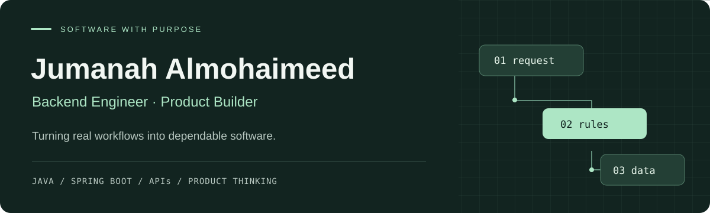

  

  
  
  
  

### Hi, I'm Jumanah 👋

Software Engineer (B.Sc. in Software Engineering, Second-Class Honors) focused on **backend development, REST API design, and product engineering**.

I combine hands-on product building with experience in **SaaS technical operations & support** and **digital transformation**—helping me spot operational friction early and translate real requirements into structured, dependable software.

When building APIs and systems, I pay close attention to:
- **Clarity & contracts:** Clean layered architecture, request validation, HTTP & error handling, and predictable state transitions.
- **Access & reliability:** Authentication/authorization, database transactions, relational modeling, and automated tests.
- **User & operational impact:** Turning manual or fragmented workflows into clear, trackable processes.

---

### Highlights & Projects

| Project / Experience | What it does | Stack & focus |
| :--- | :--- | :--- |
| **[Takween](https://tkweentech.com)** | Founded and shipped a live team-formation platform that has supported **15 teams** across hackathons, academic, and personal projects. | Next.js · TypeScript · Supabase · Vercel · Auth & DB workflows |
| **[Masar Workflow API](https://github.com/juumanah/masar-workflow-api)** | REST API to create, list, retrieve, approve, and reject requests with validation, `404` handling, state transitions, and automated tests. | Java · Spring Boot · Spring Data JPA · PostgreSQL · Layered architecture |
| **[Qawaed](https://github.com/juumanah/Qawaed)** | Keeps compliance submissions, reviews, and decisions auditable across organizations. | NestJS · TypeScript · Multi-tenancy · Audit Trail · Background Jobs |

---

### Tech Stack & Engineering Practices

#### Backend

  
  
  
  
  
  
  
  
  

#### Frontend

  
  
  
  

#### Tools & Platforms

  
  
  
  
  
  
  

#### Engineering Practices

  
  
  
  
  
  
  
  

---

### Beyond Code

- Growing **Takween** with technical communities and sharing hackathon opportunities.
- Creating accessible Arabic tech and educational content.
- Open to **Software Engineer / Backend Developer** roles across major cities in Saudi Arabia.

  

